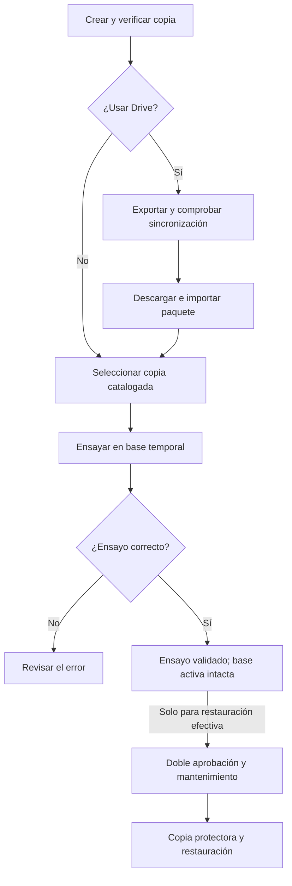

# Referencia técnica del SGTM


**Instalación y configuración**

- [Actualización para el circuito de coloquio](#instalacion-actualizacion-coloquio)
- [Dos entornos de negocio: instalación y demostración](#instalacion-entornos)
- [Dos estaciones Windows, una base compartida](#instalacion-red-privada)
- [Prueba local de respaldo y recuperación](#instalacion-respaldos-locales-demo)
- [Seguridad e instalación](#instalacion-seguridad)

**Arquitectura y modelo**

- [Estados del circuito actual](#arquitectura-estados-circuito-actual)
- [Organización de la solución](#arquitectura-estructura-solucion)
- [Fechas y zona horaria del taller](#arquitectura-fechas-y-zona-horaria)
- [Modelo relacional vigente](#arquitectura-modelo-relacional)

**Respaldo y recuperación**

- [Respaldo transportable con Google Drive](#respaldos-google-drive)
- [Respaldos y restauración de SGTM](#respaldos-operacion)

**Desarrollo y demostración**

- [Trabajo con Git](#desarrollo-git)
- [Alcance implementado](#especificacion-alcance-implementado)
- [Lote ampliado de demostración v5](#pruebas-catalogo-demo)
- [Recorridos para defender el backend](#pruebas-defensa-circuito)

<a id="instalacion-actualizacion-coloquio"></a>

## Actualización para el circuito de coloquio

Esta versión cambia reglas y restricciones: no es solamente una reorganización visual. Guardar los cambios propios, actualizar main y comprobar que ambos equipos usan el mismo commit antes de probar. No generar migraciones en cada PC.

### Base existente

Cerrar SGTM en todas las estaciones y detener el agente antes de actualizar el esquema. Conservar un respaldo independiente de la base que se desee preservar. En SSMS, sobre la conexión confirmada, comprobar:

```sql
USE SGTM_DB_Demo;
SELECT MigrationId FROM dbo.__EFMigrationsHistory ORDER BY MigrationId;
SELECT EstadoEjecucion, COUNT(*) AS Cantidad
FROM dbo.PresupuestoDetalles GROUP BY EstadoEjecucion;
```

El esquema actual tiene seis migraciones. Las dos primeras son EsquemaInicialCircuitoActual y SimplificarEjecucionTresEstados; las restantes se detallan más abajo. Si existen Parcial u Omitido, la segunda migración rechaza la actualización antes de cambiar datos. No se convierten en Completado ni se reabren atenciones cerradas silenciosamente.

- **Demo anterior descartable:** conservar una copia si interesa y, confirmado el destino, eliminar únicamente SGTM_DB_Demo desde SSMS y cargar el lote v5 según [replicar Demo](scripts/recursos/replicar-demo.txt). Se mantiene el nombre acordado, no crear otra base para cada prueba. La eliminación pierde los registros propios; no es necesaria para actualizar el código; solo para sustituir el lote anterior por v5.
- **Base con información que se quiere conservar y sin estados retirados:** aplicar todas las migraciones pendientes existentes. Revisar primero sobre una copia. Desde la raíz, con SGTM_CONN hacia el destino correcto y dotnet-ef instalado en la versión del proyecto:

```powershell
dotnet ef database update --project Taller/Taller.Infraestructura --startup-project Taller/Taller.Infraestructura
```

- **Datos reales con estados retirados:** detener la actualización y definir una conversión supervisada de esos casos. No borrar datos comerciales para hacer pasar una migración.

En Demo v5 el cargador aplica las seis migraciones antes del lote. Mantiene 88 clientes, 256 vehículos, 240 atenciones y 354 conceptos. Incluye selección validada sin cambios, reformulaciones, tres estados de ejecución, inspecciones y pagos. Los conteos de reportes pueden variar respecto de v3. No volver a cargar sobre una base poblada.

### Respaldos y todas las estaciones

Actualizar el esquema una sola vez desde el servidor, con los clientes cerrados. La aplicación de escritorio no aplica migraciones al arrancar. Actualizar después todos los ejecutables/perfiles antes de reanudar operaciones. No mezclar clientes de las dos versiones.

Si se recreó Demo, sus respaldos previos pertenecen a otra familia/esquema: no restaurarlos sobre una base recreada. Si ya se instaló una base de control de Demo, conservar su copia/catálogo anterior y coordinar su preparación con el responsable técnico antes de habilitar el módulo para la base recreada. No borrar ni reutilizar a ciegas una base de control real. Ver [respaldos](#instalacion-respaldos-locales-demo).

Los tres DOCX académicos y los diagramas v2.0 describen las reglas actuales; ver la matriz de trazabilidad.

### Limpieza documental y de esquema del 29/10/2026

La tercera migración `20261029090000_RetirarVinculoCambioSinUso` retira únicamente IdPresupuestoCambio, su FK, índice y CHECK. Las revisiones válidas usan Presupuesto.IdPresupuestoAnterior. No cambia estados, precios, solicitudes ni cobros del lote.

Para una base ya actualizada a tres estados: respaldar, cerrar todos los puestos y agente, confirmar destino y aplicar `dotnet ef database update` con los proyectos indicados arriba. No crear otra migración ni recrear la base por esta limpieza. Si hay vínculos antiguos no nulos, la migración se detiene sin borrarlos; solicitar revisión de esos registros. La reversión técnica reconstruye la columna nullable, no recupera valores descartados; por eso se impide descartarlos en Up.

Aplicar el mismo código en todas las estaciones. Las copias anteriores a la tercera migración no se deben restaurar como si tuvieran el esquema actual: el ensayo comprueba compatibilidad. Conservarlas identificadas y crear una completa nueva tras la actualización verificada.

### Teléfono obligatorio del cliente

La migración `20261029190000_ExigirTelefonoContactoCliente` exige contacto telefónico de 7 a 15 dígitos. Antes de actualizar, completar los contactos faltantes o inválidos con datos reales mediante la versión anterior. La migración se detiene con el error 51142 si detecta alguno; no elimina clientes ni inventa teléfonos. Después de corregirlos, volver a ejecutar la actualización. El lote de demostración ya incluye contacto en clientes activos e inactivos.

Consulta previa, de solo lectura, para localizar contactos ausentes o evidentemente incompletos:

```sql
SELECT IdCliente, Nombre, Apellido, Telefono
FROM dbo.Clientes
WHERE Telefono IS NULL OR LEN(LTRIM(RTRIM(Telefono))) < 7;
```

Esta consulta inicial no reemplaza la validación completa de formato aplicada por la migración. Respaldar la base y cerrar los puestos antes de actualizar el esquema.

### Concurrencia de usuarios

`20261029210000_AgregarConcurrenciaUsuarios` agrega Usuarios.Version y actualiza los SP de edición, credenciales y estado. Conserva datos y procedimientos de alta. Los tres SP exigen la versión consultada. Una edición obsoleta produce un conflicto y no sobrescribe cambios.

Respaldar previamente, cerrar todos los puestos y aplicar todas las migraciones pendientes desde una única estación de mantenimiento. Actualizar luego todos los clientes. No mezclar ejecutables antiguos con los SP nuevos ni generar otra migración por cuenta propia. No es necesario recrear una base actualizada ni recargar Demo.

### Contacto de la decisión del presupuesto

La sexta migración `20261029220000_ExigirContactoDecisionPresupuesto` agrega CK_Presupuestos_ContactoDecision. Las decisiones aceptadas, rechazadas o pendientes de revisión técnica requieren persona y medio Presencial, Teléfono, Correo o Mensajería. Si hay decisiones incompletas se detiene con error 51144, sin inventar datos ni eliminar propuestas. Revisar con el responsable técnico la evidencia real de esos registros y corregirlos de forma supervisada; después repetir la actualización. No recrear una base válida ni recargar el lote para evitar el control.

Consulta previa de solo lectura:

```sql
SELECT IdPresupuesto, Estado, PersonaDecision, MedioDecision
FROM dbo.Presupuestos
WHERE Estado IN (N'Aceptado', N'Rechazado', N'PendienteRevisionTecnica')
AND (PersonaDecision IS NULL OR LEN(LTRIM(RTRIM(PersonaDecision)))=0
     OR MedioDecision IS NULL
     OR MedioDecision NOT IN (N'Presencial', N'Teléfono', N'Correo', N'Mensajería'));
```

Cerrar clientes y agente, respaldar, confirmar el destino y ejecutar la actualización completa una sola vez. Verificar seis filas en __EFMigrationsHistory, actualizar todos los ejecutables y crear una completa nueva tras comprobar el circuito. Las copias con un esquema anterior se conservan identificadas para recuperación técnica, no se presentan como compatibles con el nuevo esquema.

### Lote ampliado Demo v5

La ampliación del lote no agrega una migración: se mantienen las seis del esquema actual. No borrar la base para actualizar el programa. Una Demo ya poblada conserva sus datos y no se mezcla con el lote nuevo.

Para sustituir voluntariamente una Demo v4 descartable por v5, respaldar, cerrar puestos/agente y confirmar en SSMS que se trata únicamente de SGTM_DB_Demo. Solo entonces eliminar esa Demo y ejecutar el cargador de la guía de réplica para que la cree con el mismo nombre. Esta decisión pierde las operaciones de prueba anteriores; no aplicarla a SGTM_DB ni a información real. Si ya existe un control de respaldos, su catálogo conserva otra familia de base: coordinar con el responsable técnico su configuración y conservar las copias anteriores identificadas, sin reutilizarlo a ciegas.

La preparación v5 corrige la coordinación con transacciones explícitas del cargador, que ahora utiliza el mismo recorrido que la prueba SQL. Los cambios no alteran estados, relaciones ni reglas de presupuesto/pago/entrega.

---

<a id="instalacion-entornos"></a>

## Dos entornos de negocio: instalación y demostración

### Bases previstas

- SGTM_DB: instalación del taller, con datos reales. Migraciones, catálogos iniciales y administrador inicial; no ejecutar el cargador académico.
- SGTM_DB_Demo: un solo lote académico coherente para pruebas y coloquio. El programa de demostración exige sufijo _Demo y base sin usuarios/clientes/vehículos/atenciones. No mezcla ni reemplaza lotes.

Los nombres SGTM_Pruebas_* son bases temporales de CI, no instalaciones que deba mantener el usuario. Al configurar respaldos existe además una base técnica de control separada del negocio: conserva programación, aprobaciones y bitácora, para no perder esa información al restaurar SGTM_DB. No constituye otro lote comercial. Cada entorno debe tener su control/configuración independiente para no apuntar a la base incorrecta.

### Preparar una base nueva (cambio de esquema)

El esquema vigente contiene seis migraciones: EsquemaInicialCircuitoActual, SimplificarEjecucionTresEstados, RetirarVinculoCambioSinUso, ExigirTelefonoContactoCliente, AgregarConcurrenciaUsuarios y ExigirContactoDecisionPresupuesto. Ver [actualización](#instalacion-actualizacion-coloquio) antes de cambiar una base existente. **Una base de una línea de migraciones retirada requiere conversión técnica; no aplicar estas migraciones a ciegas. Una base de la línea actual se actualiza sin recrearla según la guía.** Se retiraron columnas, clasificaciones y rutas antiguas por decisión de alcance del proyecto.

1. Guardar y actualizar el código. Cerrar aplicación y agente de respaldos del entorno que va a reemplazarse.
2. En SSMS confirmar la instancia y base Demo. Para los equipos de demostración se usa SGTM_DB_Demo. Si aún contiene el esquema anterior y se decidió descartar ese lote, eliminar únicamente esa base desde SSMS, confirmando el destino. El cargador la recrea; no hace falta inventar otro nombre.
3. Configurar la conexión a esa base vacía y ejecutar el cargador siguiente. Aplica el esquema actual y construye el lote completo. No ejecutar primero la aplicación: esta crearía el administrador y el cargador exige una base sin usuarios.

Después, desde la raíz del repositorio, en PowerShell:

```powershell
$env:SGTM_CONN = 'Server=localhost\SQLEXPRESS;Database=SGTM_DB_Demo;Integrated Security=True;Encrypt=True;TrustServerCertificate=True'
Remove-Item Env:SGTM_ADMIN_INICIAL_PASSWORD -ErrorAction SilentlyContinue
$claveDemo = Read-Host 'Clave de demostración' -AsSecureString
$env:SGTM_DEMO_PASSWORD = [System.Net.NetworkCredential]::new('', $claveDemo).Password
dotnet run --project Taller/Taller.Demostracion -- --cargar-demo
Remove-Item Env:SGTM_DEMO_PASSWORD
```

Exige clave de 12 a 100 caracteres, mayúscula, minúscula, número y símbolo. Retirar SGTM_ADMIN_INICIAL_PASSWORD si quedó de una instalación anterior para que el lote use la clave elegida. No registrar contraseñas en Git. Las migraciones se aplican antes del lote; si falla la transacción comercial, no continuar con supuestos de carga completa. Una segunda ejecución rechaza la mezcla.

Visual Studio debe usar SGTM_CONN de su propio perfil/proceso o ConnectionStrings:Default en appsettings.Local.json; cambiar una variable de otra terminal no cambia un Visual Studio ya abierto. Para copias independientes del coloquio, cada equipo carga su SGTM_DB_Demo local con el mismo main. Si se desea trabajar simultáneamente sobre una sola atención, ambos puestos deben apuntar a una instancia/base compartida; localhost de cada equipo no sincroniza datos. No activar respaldos hasta verificar configuración de mantenimiento y control del entorno seleccionado.

### Instalación del taller sin demostración

1. Publicar la aplicación para Windows con el runtime correspondiente al proyecto o autocontenida; preparar SQL Server y su identidad de acceso.
2. Configurar SGTM_CONN o ConnectionStrings:Default para SGTM_DB. No distribuir las credenciales del desarrollador. Configurar nombre/contacto/logo del taller.
3. Aplicar todas las migraciones de Infraestructura sobre el destino nuevo confirmado mediante `dotnet ef database update --project Taller/Taller.Infraestructura --startup-project Taller/Taller.Infraestructura`. La base vacía debe recibir las seis migraciones, incluida ExigirContactoDecisionPresupuesto.
4. Suministrar SGTM_ADMIN_INICIAL_PASSWORD de forma local y temporal para crear el administrador al primer inicio; retirarla después. Crear usuarios operativos con sus roles y credenciales.
5. Confirmar conexión, catálogos, permisos y un recorrido de aceptación en el entorno de prueba antes de operar datos reales.
6. Configurar el agente de respaldos y su base de control con permisos separados. Probar recuperación en una copia antes de habilitarla como procedimiento operativo.

### Google Drive: respaldo transportable

El negocio sigue conectado a SQL Server. SQL escribe la copia nativa en una carpeta local con permisos. SGTM exporta un paquete transportable a una carpeta de Google Drive para escritorio; una diferencial incluye su completa base. El paquete no contiene la base de control. No requiere claves API ni mover la base SQL a la nube. Para automatizar Drive se instala el agente como tarea de inicio de sesión con la misma cuenta Windows que usa Drive; el equipo y la sesión deben permanecer disponibles. Ver [preparación, importación y automatización](#respaldos-google-drive). SGTM verifica los archivos locales; comprobar la sincronización completada en Drive web.

### Verificación antes de F5

El cargador informa DEMO v5 completo: 88 clientes (8 inactivos), 256 vehículos (2 inactivos) y 240 atenciones. El catálogo contiene 353 conceptos de oferta más uno inactivo para filtros. Cada precio y unidad se define expresamente, sin precios genéricos heredados del catálogo mínimo.

En SSMS, sobre la base elegida:

```sql
SELECT MigrationId FROM dbo.__EFMigrationsHistory;
SELECT Estado, COUNT(*) AS Cantidad FROM dbo.Atenciones GROUP BY Estado;
SELECT COUNT(*) AS Conceptos FROM dbo.Conceptos;
```

Deben existir las seis migraciones indicadas al principio, hasta ExigirContactoDecisionPresupuesto, y siete estados de atención admitidos por las restricciones. No debe generar migraciones nuevas en su PC: aplicar las existentes. Al abrir Visual Studio configurar la misma base del cargador, reconstruir y ejecutar. La producción vacía lleva solo inicialización mínima y cuentas reales, no el lote académico.

Los respaldos anteriores no corresponden al esquema actual. El registro y la base técnica de respaldos se configurarán para este entorno nuevo al preparar Google Drive. La conexión SQL, el control y la carpeta de sincronización son configuraciones distintas.

---

<a id="instalacion-red-privada"></a>

## Dos estaciones Windows, una base compartida

### Disposición

Un equipo Windows hospeda SQL Server/Express y puede ejecutar recepción; el otro ejecuta SGTM como técnico. Ambos consultan la misma SGTM_DB_Demo. La base se carga una sola vez en el servidor. localhost en cada notebook apuntaría a dos instalaciones diferentes, no a una base compartida.

1. Elegir el equipo servidor, conectar ambos a una red privada controlada y comprobar que la red no aísle clientes Wi-Fi. Reservar una IP estable para la demostración. No depender del Wi-Fi público de la facultad.
2. En SQL Server Configuration Manager habilitar TCP/IP para la instancia del servidor y configurar un puerto TCP fijo disponible. Reiniciar SQL Server de manera coordinada. No asumir que Express ya escucha remotamente ni que usa siempre 1433.
3. En el firewall del servidor permitir ese puerto solo en perfil privado y limitado a la IP/subred de las estaciones. No abrirlo en el router hacia Internet ni desactivar todo el firewall.
4. En el cliente ejecutar Test-NetConnection IP_DEL_SERVIDOR -Port PUERTO. Si falla, resolver red/puerto antes de probar credenciales.
5. Configurar una identidad SQL autorizada para cada estación. Windows Authentication no funciona automáticamente por tener dos PC con usuarios de nombre parecido. En un grupo de trabajo puede configurarse un login SQL dedicado con permisos acotados; no usar sa ni compartir credenciales de mantenimiento en todas las estaciones. La cuenta interna de SGTM es independiente del login SQL.
6. En ambos perfiles configurar SGTM_CONN hacia Server=tcp:IP_DEL_SERVIDOR,PUERTO;Database=SGTM_DB_Demo;... con la autenticación y cifrado acordados. No es una cadena completa lista para pegar: incorporar la identidad instalada. Para datos reales usar un certificado confiable y TrustServerCertificate=False; la excepción de certificado local queda limitada a Demo.
7. Abrir SGTM en ambos con el mismo commit. Recepción crea una atención nueva y anota número/dominio; técnico usa Actualizar y la busca. Técnico envía propuesta; recepción actualiza, informa y acepta. Técnico actualiza, ejecuta y finaliza; recepción actualiza, liquida, cobra y entrega.
8. Probar dos intentos sobre una misma reserva/versión y dos cobros sobre el mismo saldo. Debe rechazarse la operación desactualizada, sin duplicados ni sobrepago. Una base compartida no implica refresco instantáneo: usar Actualizar; la ejecución sí consulta pausas periódicamente.

### Respaldos compartidos

Los .bak se escriben en el servidor SQL. Una carpeta C:\SGTM\Respaldos del servidor no es la carpeta de la segunda notebook. Instalar un único agente junto a SQL y compartir la misma BaseControl en ambas estaciones. Habilitar coordinación en todos los clientes antes de restaurar. La estación prevista para restauración necesita permisos técnicos separados; no otorgarlos a todos los operadores.

Ensayar previamente con ambas notebooks y llevar una copia externa verificada. La configuración real de red y cuentas debe realizarse en los equipos; el repositorio no puede habilitar su firewall ni comprobar su conectividad por sí solo.

---

<a id="instalacion-respaldos-locales-demo"></a>

## Prueba local de respaldo y recuperación

Usar Demo v5 y el servidor seleccionado. Google Drive no es requisito para este recorrido. Distinguir usuarios internos SGTM de identidades SQL, servicio Windows y permisos de archivos. Estos pasos requieren acceso técnico al servidor, no se ejecutan automáticamente al actualizar Git.

### Preparación técnica

1. Cerrar las aplicaciones. Crear C:\SGTM\Respaldos en el servidor SQL. Identificar la cuenta del servicio SQL Server desde su administrador de configuración y concederle lectura/escritura sobre esa carpeta. La identidad de mantenimiento necesita los permisos SQL detallados en [operación](#respaldos-operacion). No dar control total a Everyone como solución.
2. Desde PowerShell en la raíz del servidor, configurar SGTM_CONN para SGTM_DB_Demo, SGTM_MANTENIMIENTO_CONN para la identidad técnica del mismo servidor, Respaldos__BaseControl=SGTM_DB_Demo_Control y Respaldos__Habilitado=false. No compartir la contraseña por chat ni guardarla en Git.
3. Ejecutar dotnet run --project Taller/Taller.Respaldos -- --instalar-control. Confirmar instalación y permisos de lectura de EstadoSGTM para cada estación; el agente y la estación que restaura necesitan los permisos adicionales documentados.
4. Solo después, establecer Respaldos__Habilitado=true y Respaldos__BaseControl=SGTM_DB_Demo_Control en los perfiles de todas las estaciones y del agente. Reiniciar clientes. Una variable del perfil prevalece sobre appsettings.Local.json. Conservar la identidad técnica en el equipo autorizado.

### Aceptación manual y recuperación

1. Administrador: abrir Respaldos y recuperación, elegir C:\SGTM\Respaldos, Completa y sin exportar todavía a Google Drive. Crear y verificar copia; comprobar ruta, historial y archivo .bak en el servidor. Verificar también el respaldo auxiliar del control o resolver su advertencia.
2. Crear un cliente ficticio identificable posterior a la copia. Generar una Diferencial y comprobar su dependencia de la completa. No eliminar ni reemplazar la completa.
3. Seleccionar la completa y Ensayar restauración. Debe recuperar una base temporal y comprobar integridad/esquema, sin borrar el cliente posterior en la base operativa.
4. Para la restauración real, acordar mantenimiento, cerrar la segunda aplicación y consultas externas sobre Demo. Administrador confirma con su contraseña y una segunda identidad distinta, administrador o administrativo, aprueba. Registrar motivo y consecuencias. No hacer este ensayo en una base real.
5. Tras restaurar, reiniciar ambas aplicaciones e ingresar con las credenciales del punto recuperado. Comprobar que el cliente posterior ya no existe al restaurar la completa; el catálogo/auditoría de control deben conservar el evento. Verificar las atenciones y saldos del punto esperado, no solo el mensaje de éxito.
6. Ensayar y restaurar completa+diferencial: el cliente incluido en la diferencial debe reaparecer. Verificar que un cliente conectado/operación activa no sea desconectado a la fuerza ni pierda transacciones; la restauración debe esperar o rechazarse según el caso.
7. Probar aprobación repetida con la misma cuenta, clave errónea, copia faltante y selección modificada después del ensayo: debe bloquearse sin reemplazar la base.

### Automatización

Publicar e instalar un solo servicio de Windows siguiendo [operación](#respaldos-operacion) y scripts/Instalar-AgenteRespaldos.ps1. La cuenta del servicio necesita acceso SQL y a la carpeta, independientemente de Visual Studio. Configurar un plan cercano con zona Argentina, guardar y comprobar señal reciente. Cerrar SGTM y verificar un archivo nuevo, fecha/historial y siguiente ejecución. Running del servicio por sí solo no acredita un respaldo.

### Nube después de la prueba local

Google Drive almacena paquetes de recuperación; la base operativa permanece en SQL Server. Seguir [Google Drive](#respaldos-google-drive): exportar el paquete completo, verificar su sincronización en la web y ensayar su importación antes de autorizar una restauración. Para automatizar con Drive para escritorio, usar la tarea de inicio de sesión documentada; un servicio de Windows no comparte automáticamente la unidad de Drive de la sesión interactiva.

### Preparación asistida de Demo en un solo equipo Windows

Esta herramienta está limitada a `SGTM_DB_Demo` e instancia SQL local con autenticación Windows. No usarla para configurar producción ni para reemplazar datos. Cerrar SGTM, agente y Visual Studio. Actualizar main antes de ejecutarla.

Abrir **Windows PowerShell como administrador de Windows**, entrar en la raíz del repositorio y ejecutar:

```powershell
powershell.exe -NoProfile -ExecutionPolicy Bypass -File .\scripts\Preparar-RespaldosDemo.ps1
```

`Bypass` se limita a ese proceso; no cambia permanentemente la política del equipo. Revisar el script antes de ejecutarlo. La cuenta Windows debe tener acceso SQL a la Demo y permisos de crear la base de control; ser administrador de Windows no concede automáticamente permisos en SQL Server.

La herramienta verifica acceso/esquema de Demo sin modificarlo, detecta la cuenta real del servicio SQL, crea `C:\SGTM\Respaldos` y concede a esa cuenta permiso Modify en esa carpeta. Instala y consulta `SGTM_DB_Demo_Control`; solo después habilita los perfiles Project F5 y prepara la configuración local del agente. Conserva las configuraciones anteriores fuera del repositorio, en `%LOCALAPPDATA%\SGTM\Configuracion`. No elimina copias, no restaura, no carga registros de negocio y no configura Google Drive. Si falla puede quedar la carpeta o la base de control creada; corregir el problema y repetir es admisible. No borre bases para resolver un fallo de preparación.

Reabrir Visual Studio, reconstruir y ejecutar el perfil Project. Entrar como `demo.admin` y abrir Respaldos y recuperación. Crear una **Completa**, carpeta `C:\SGTM\Respaldos`, sin exportar todavía a Google Drive. Comprobar el mensaje, el archivo `.bak` y el catálogo. Esta copia real es la que comprueba los permisos efectivos de respaldo SQL y del sistema de archivos. Una carpeta creada o control consultable por sí solos no garantizan una copia correcta.

#### Comprobación de programación antes de instalar un servicio

En otra PowerShell, con la misma cuenta Windows autorizada, desde la raíz:

```powershell
powershell.exe -NoProfile -ExecutionPolicy Bypass -File .\scripts\Iniciar-AgenteDemo.ps1
```

Dejar esa terminal abierta. Como administrador SGTM, guardar un plan diario completo a unos minutos de la hora actual, zona Argentina y carpeta anterior. Actualizar estado hasta ver señal reciente y comprobar que aparece una copia nueva al llegar el horario, incluso cerrando SGTM. El agente consulta cada minuto. `Ctrl+C` o cerrar esa terminal detiene este modo de demostración; no presentarlo como servicio permanente. Para ejecución automática al arrancar Windows sin terminal, publicar e instalar el servicio con `Instalar-AgenteRespaldos.ps1` y su cuenta técnica, según la guía de operación.

Para probar recuperación, seguir «Aceptación manual y recuperación» de esta guía. Primero ensayo sobre base temporal; después, si se decide reemplazar la Demo, doble aprobación y ventana de mantenimiento. No ejecutar una restauración mientras la segunda PC opera. En dos equipos, solo el servidor prepara carpeta/control/agente; todas las aplicaciones deben tener la misma base compartida y coordinación de mantenimiento activada. La configuración local F5 no configura conexiones de una aplicación publicada.

---

<a id="instalacion-seguridad"></a>

## Seguridad e instalación

### Qué protege la aplicación

- Los servicios revalidan el usuario y su rol en persistencia antes de cada operación protegida. La visibilidad del menú no constituye autorización.
- Las ediciones y transiciones del circuito conservan los tokens rowversion. Los cobros conservan su identificador de intento para no duplicarlos al reintentar.
- Contraseñas mediante PasswordHasher de Microsoft Identity; no se almacenan en texto ni se incluyen en la consulta de auditoría.
- Cinco rechazos de credenciales por identidad normalizada dentro de 15 minutos bloquean nuevos intentos durante 15 minutos. El contador es SQL compartido entre estaciones. No se informa si la cuenta existe.
- Auditoría de autenticaciones correctas/rechazadas en `EventosAcceso`, consultable exclusivamente por administrador (máximo 500 resultados por período). Los nombres no reconocidos no se guardan en claro; la clave del contador es SHA-256. El registro refleja intentos procesados; solicitudes ya bloqueadas o sintácticamente inválidas no generan nuevos eventos.
- Sesión sin vencimiento temporal: se conserva hasta cerrar sesión o salir de la aplicación. Los servicios revalidan usuario habilitado y rol persistido antes de autorizar operaciones. Al dejar el puesto sin supervisión, bloquear Windows o cerrar sesión. Las aprobaciones y la vigencia de planes de restauración mantienen sus verificaciones independientes.
- Restauraciones con ensayo separado, comprobaciones de integridad, doble aprobación y coordinación SQL ya existentes. Credenciales de nube mediante identidad Entra, sin SAS ni claves en el catálogo de copias.

### Primera instalación

Sobre una base nueva, aplicar todas las migraciones vigentes según [entornos](#instalacion-entornos). Incluye las tablas de seguridad; no se aplican migraciones retiradas sobre una base antigua. Para Demo, el cargador aplica el esquema antes de crear los usuarios.

Una base sin usuarios necesita una credencial inicial suministrada por el instalador. En PowerShell, solicítela sin escribirla literalmente en el historial:

```powershell
$claveSegura = Read-Host 'Contraseña inicial del administrador' -AsSecureString
$env:SGTM_ADMIN_INICIAL_PASSWORD = [System.Net.NetworkCredential]::new('', $claveSegura).Password
## Ejecute la aplicación desde esta misma terminal, con SGTM_CONN configurada.
dotnet run --project Taller/Taller.Presentacion
Remove-Item Env:SGTM_ADMIN_INICIAL_PASSWORD
```

Mínimo 12 caracteres con mayúsculas, minúsculas, números y símbolo; máximo 100. El nombre inicial es `admin`. Nunca se recrea automáticamente una cuenta deshabilitada ni se recupera un acceso cambiando contraseñas silenciosamente. Si ya hay usuarios y ningún administrador activo, debe intervenir el responsable técnico.

Cambiar credenciales temporales desde Usuarios / Credenciales antes de usar datos reales. No publicar contraseñas en una guía ni en Git.

### Límites y configuración del equipo

Esta es una aplicación de escritorio que se conecta directamente a SQL Server: quien controle la PC, el proceso o credenciales SQL con permisos de escritura puede eludir las reglas del cliente. No es una API con un servidor de autorización independiente. La auditoría comercial y de accesos no es inviolable frente a un administrador de base de datos. Para un despliegue con estaciones no confiables se requiere una API intermedia y credenciales de base exclusivamente en el servidor.

- No otorgar `sysadmin` a todos los operadores. Separar la identidad de negocio de la de mantenimiento/restauración; conceder solo los permisos necesarios y proteger el servicio de respaldos.
- Restringir red/firewall de SQL, cuentas de Windows, carpeta de respaldos y carpeta de registros. En producción instalar un certificado válido de SQL y usar `Encrypt=True;TrustServerCertificate=False`. `TrustServerCertificate=True` queda para la prueba local con certificado no confiable.
- Aplicar bloqueo de pantalla de Windows. La sesión persistente requiere proteger físicamente la estación.
- Mantener sistema operativo, SQL Server y dependencias actualizados. Revisar accesos rechazados y guardar respaldos fuera del equipo.
- La limitación por nombre reduce intentos de adivinación; no reemplaza controles de red contra ataques masivos o distribuidos y puede bloquear temporalmente una cuenta atacada.
- Los registros técnicos pueden contener información operativa en excepciones SQL. No se deben publicar. La presentación no muestra excepciones técnicas completas al iniciar.
- Proteger con permisos SQL `ControlesAcceso` y `EventosAcceso`; definir con el responsable técnico una retención acorde al uso y a los requisitos de datos personales. No se elimina auditoría automáticamente.

### Verificación

Hay pruebas de sesión sin vencimiento temporal y revocación de autorización, instalación sin contraseña fija, validación de paquetes y rutas de Drive y pruebas SQL del contador persistente y lote completo. La autorización, integridad del circuito y concurrencia cuentan además con las pruebas de integración existentes. La sincronización remota de Drive y la aceptación visual en Windows deben probarse en la instalación; compilar no demuestra seguridad absoluta.

### Política común de contraseñas

Alta y gestión de credenciales utilizan `UsuarioServicio.ValidarPassword`: contraseña no vacía, de 8 a 100 caracteres, conservada exactamente como fue ingresada. No se exige una composición específica. Los dos formularios usan los mismos límites y generador; las contraseñas se almacenan mediante hash. Modificar únicamente el nombre de acceso no obliga a reemplazar la contraseña.

La inicialización mínima se serializa entre puestos mediante sp_getapplock y una transacción SQL. No reemplaza la instalación de migraciones. La configuración del cliente publicado se resuelve desde la carpeta del ejecutable, independientemente del directorio de trabajo del acceso directo.

---

<a id="arquitectura-estados-circuito-actual"></a>

## Estados del circuito actual

La base se construye desde cero mediante EsquemaInicialCircuitoActual. No se conservan estados ni rutas de compatibilidad: Abierta, PendienteDiagnostico y Pausada fueron retirados del dominio, las consultas, los filtros y las restricciones del esquema e historial. La recepción se guarda directamente en EnEvaluacionTecnica con un único evento RecepcionRegistrada. No se convierten historiales anteriores: este esquema requiere una base nueva.

| Estado de atención | Uso y operación responsable |
|---|---|
| EnEvaluacionTecnica | Recepción individual; disponible/reservada se distingue por IdTecnicoEnActividad y ActividadTecnica. También revisiones antes de ejecutar. |
| PendienteDecision | Propuesta principal informada, esperando respuesta; una selección parcial sigue sin autorizar ejecución. |
| EnEjecucion | Reparación autorizada; permite trabajo, pausas y adicionales sin borrar el acuerdo original. |
| TrabajoFinalizado | Terminación normal y conformidad técnica. Recepción liquida/cobra/entrega. |
| PendienteLiquidacion | Rechazo de reparación o evaluación sin propuesta de reparación. Se cobra solo lo autorizado y realizado, incluso si el resultado es cero. |
| Cerrada | Entrega registrada con liquidación saldada. |
| Cancelada | Desistimiento previo a actividad técnica, presupuestos o servicios autorizados; conserva motivo e historial. |


### Presupuesto y ejecución

Los seis EstadoPresupuesto tienen funciones diferentes y se conservan: Borrador, PendientePresentacion, PendienteDecision, PendienteRevisionTecnica, Aceptado y Rechazado. Vigente distingue la versión aplicable sin inventar un estado de reemplazo. Una reformulación conserva el original y genera otra propuesta. Validar sin cambios la selección del cliente conserva el mismo presupuesto y su decisión original. El presupuesto aceptado no equivale a trabajo ejecutado ni cobro recibido.

Los tres EstadoEjecucionDetalle son NoIniciado, EnCurso y Completado. Una cantidad realizada menor que la autorizada permanece EnCurso; no es un cierre definitivo. Completado exige toda la cantidad autorizada. No se disminuye el avance registrado ni se revierte un completado. Finalizar exige todos los ítems autorizados completados y conformidad técnica. Una pausa conserva el avance y bloquea el alcance; no es otro estado de ejecución. El cierre con interrupción queda fuera de esta entrega.

La migración SimplificarEjecucionTresEstados retira las restricciones antiguas sin reinterpretar datos: si existen Parcial/Omitido rechaza la actualización. Ver [actualización](#instalacion-actualizacion-coloquio).

### Otras enumeraciones y atributos

- TipoSolicitudIngreso: TrabajoSolicitado / ProblemaInformado, expresado por cada pedido. TipoSolicitudAtencion (Problema, ServicioDefinido, Mixta) es el resumen derivado, no una tercera pregunta de ingreso.
- ActividadTecnica: Diagnostico, Presupuesto, Ejecucion. Identifica reserva y permisos, no duplica el estado de la atención.
- Presupuesto no necesita un enum de tipo: todos son propuestas. EsAdicional/EsInspeccion distinguen alcances realmente usados. Se retiraron TipoPresupuesto y su columna Tipo.
- Diagnostico es el informe definitivo de evaluación, único por atención. Los hallazgos usan HallazgoAtencion. Se retiraron TipoDiagnostico, su columna Tipo y el indicador ImpideContinuar del diagnóstico, que duplicaba un comportamiento exclusivo del hallazgo.
- TipoConcepto: Servicio / Repuesto / Consumible. Determina validación de materiales aportados y la oferta del catálogo.
- OrigenMaterial: Taller / Cliente; el aporte del cliente tiene precio de venta cero y requiere recepción/conformidad antes de utilizarse.
- Cliente, vehículo, usuario y catálogos emplean Activo; no necesitan un enum adicional. Pago conserva Anulado y su motivo, no un borrado. Comprobante conserva total/pagado/saldo, no un estado de pago redundante. Pausa conserva resolución/fecha; no necesita otro enum.
- TipoRespaldo: Completa / Diferencial (no respaldo de log ni incremental encadenado). Ambos tienen implementación.
- TipoReporte: siete consultas diferentes; TipoGraficoReporte: Barras, Columnas, Torta; PermisoAplicacion conserva las capacidades de navegación por rol. Son tipos/capacidades, no estados comerciales.


### Opciones agrupadas del listado

Finalizadas no es un enum ni un estado guardado: es un filtro de consulta que selecciona Cerrada o Cancelada. En curso selecciona las restantes; Pendientes de entrega se deriva de cierre técnico, liquidación y saldo cero. TrabajoFinalizado es distinto de Cerrada: el técnico terminó, pero todavía puede faltar liquidar/cobrar/entregar. La agrupación visual no conserva estados retirados ni altera los registros.

---

<a id="arquitectura-estructura-solucion"></a>

## Organización de la solución

Abrir `Taller/Taller.sln` para ver el proyecto completo. Las carpetas de solución separan responsabilidades, sin añadir capas:

| Carpeta de Visual Studio | Proyectos | Propósito |
|---|---|---|
| 01 Sistema (cuatro capas) | Taller.Dominio, Taller.Aplicacion, Taller.Infraestructura, Taller.Presentacion | Aplicación de negocio y sus cuatro capas. |
| 02 Herramientas | Taller.Demostracion, Taller.Respaldos | Preparar el lote académico y ejecutar copias programadas independientemente de la interfaz. |
| 03 Pruebas | Taller.Pruebas, Taller.Pruebas.Interfaz | Verificar reglas, SQL, documentos y construcción de formularios. No se distribuyen al usuario. |
| 04 Documentacion | Índice de documentación, instructivo TXT y guía de organización | Acceso al circuito, estados, preparación de la base y demostración. |

Para ver solo las cuatro capas abrir `Taller/Taller.Sistema.slnf`. Es un filtro de la misma solución: usa los mismos archivos y proyectos. No duplica código ni elimina herramientas. Para volver a verlas, abrir Taller.sln. En Visual Studio elegir Taller.Presentacion como proyecto de inicio para F5; esta selección es local a cada equipo.

### Carpetas físicas

Los ocho proyectos continúan en directorios identificados por su nombre dentro de Taller. No se movieron: esto conserva rutas de referencias, comandos, migraciones y CI. Las carpetas numeradas son agrupaciones virtuales de Visual Studio; no son directorios adicionales de Windows. En el explorador se distinguen por los nombres Taller.Demostracion, Taller.Pruebas, Taller.Pruebas.Interfaz y Taller.Respaldos.

### Referencias e inyección de dependencias

- Dominio no referencia otros proyectos del sistema.
- Aplicación referencia Dominio. Define contratos y coordina operaciones; no referencia EF, Infraestructura ni formularios.
- Infraestructura referencia Aplicación y Dominio e implementa los contratos con EF/SQL y servicios técnicos.
- Presentación referencia Aplicación e Infraestructura. Program es el punto de composición: registra ambas mediante AddAplicacion, AddInfraestructura y AddPresentacion. Los formularios invocan servicios; no ejecutan consultas SQL. El tratamiento visual de errores técnicos conserva mensajes sanitizados.
- Las herramientas y pruebas utilizan esas capas. Las cuatro capas no dependen de ellas.

La sesión es Singleton y se comparte entre formularios. Servicios, repositorios y DbContext son Scoped; formularios son Transient según su registro. AplicacionContexto gestiona los alcances de acceso y de la sesión visual. La construcción de interfaz en Windows verifica los registros con ValidateOnBuild y ValidateScopes, además de crear formularios. Las pruebas de arquitectura comprueban que Dominio, Aplicación e Infraestructura no incorporen referencias invertidas.

### Sesión y autorizaciones

La sesión no vence por tiempo ni inactividad. Termina por Cerrar sesión o salir de la aplicación. El tiempo sin clientes no obliga a autenticarse nuevamente. La identidad se mantiene en memoria; los servicios revalidan la cuenta activa y el rol contra persistencia al autorizar una operación. Deshabilitar un usuario no le permite seguir operando por conservar una ventana abierta. Las aprobaciones y vencimientos de planes de restauración son independientes y se mantienen.

### Preparación para el coloquio

1. Descargar la misma versión de main en ambos equipos.
2. Preparar la base nueva con la guía de entornos y cargar Demo v5 antes de abrir la aplicación. No aplicar el esquema inicial sobre la base anterior.
3. Configurar en cada equipo la conexión al destino elegido y seleccionar Taller.Presentacion como inicio.
4. Ejecutar el recorrido principal con cuentas de recepción y técnico. Si ambas máquinas colaboran sobre el mismo circuito, deben usar la misma instancia/base accesible; localhost de cada equipo representa bases diferentes.
5. Las configuraciones de Google Drive y del agente se realizan después. La versión actual requiere aplicar todas las migraciones, incluida AgregarConcurrenciaUsuarios, con los puestos cerrados. Después actualizar todos los ejecutables antes de reanudar operaciones.

La instalación del puesto incluye Presentación y sus dependencias. Demostración se utiliza para preparar datos académicos, no al iniciar una instalación real. El agente de respaldos se despliega por separado en un equipo disponible para ejecutar las tareas programadas.

Los archivos de pruebas están agrupados en Arquitectura, ReglasYComponentes e IntegracionSql dentro del mismo proyecto. Los namespaces y filtros de CI se conservan; mover los archivos no cambia las pruebas ejecutadas. Los editables v2.0 de docs/ERS y los diagramas de docs/diagramas están vinculados en la matriz de trazabilidad.

---

<a id="arquitectura-fechas-y-zona-horaria"></a>

## Fechas y zona horaria del taller

La instalación actual corresponde a un taller de Argentina. `FechaHoraTaller` centraliza la zona America/Argentina/Buenos_Aires (Argentina Standard Time en Windows), la fecha de hoy, la hora operativa y las conversiones de instantes. Ningún módulo debe usar la zona local de la estación para interpretar datos del negocio. Cambiar la zona de esta instalación requiere una revisión técnica del histórico; no es una preferencia visual individual.

| Datos | Almacenamiento y uso |
|---|---|
| Clientes, vehículos y usuarios: fecha de alta | DateTime civil de Argentina. |
| Apertura/cierre, evaluaciones, diagnósticos, presupuestos y decisiones | DateTime civil de Argentina. |
| Historial, hallazgos, pausas, materiales y ejecución | DateTime civil de Argentina. |
| Comprobantes, cobros y anulaciones | DateTime civil de Argentina. |
| Accesos, bloqueo de intentos, control, réplica y plazos de respaldo | DateTimeOffset UTC. Se convierten al mostrarlos al operador. |
| Fecha nativa de finalización del archivo .bak | Hora que declara SQL Server; se etiqueta como hora del servidor, porque el encabezado no contiene zona. No se deduce su offset. |
| Programación automática | Hora civil y zona del plan; próxima ejecución y plazos se calculan/comparan como instantes UTC. |
| Año del vehículo y filtros de días | Valores civiles, no instantes ni conversiones automáticas a UTC. |

### Integridad del histórico

Los campos DateTime del negocio ya se guardaban como hora local. Se preservan sin moverlos tres horas ni cambiar su tipo. Desde este ajuste las nuevas fechas se generan explícitamente en Argentina, incluso si una PC está en otra zona. No se realizó una migración de datos ni se afirma que los campos comerciales existentes estén almacenados en UTC.

Este criterio es compatible con el alcance de una única sede argentina. Migrar toda la historia comercial a UTC requeriría una migración específica, con respaldo, identificación de la zona de los registros antiguos y adaptación coordinada de procedimientos/consultas/clientes. No se mezcla UTC y hora civil dentro de una misma columna.

### Consulta y presentación

- Inicio, calendario, alta de atención, fechas de referencia y emisión de documentos usan la hora operativa argentina.
- Auditoría muestra fecha y hora de Argentina. El repositorio conserva UTC; un filtro de un día se transforma en el intervalo [00:00 del taller, 00:00 del día siguiente), convertido a UTC. Incluye todo el último día sin depender de la zona de Windows.
- Los filtros de los reportes comerciales operan directamente sobre fechas civiles del taller. Saldos/carga actuales mantienen su alcance sin fecha según la metodología del reporte.
- Las comparaciones de autorización de restauración, bloqueos y señales del agente conservan el uso de instantes UTC/TimeProvider; no se comparan con una fecha civil.
- La señal y el vencimiento del plan de restauración se muestran convertidos, conservando UTC internamente. La próxima copia muestra explícitamente la zona elegida en su programación.
- Los registros técnicos/CLI pueden conservar UTC si lo identifican expresamente.

Mantener sincronizados Windows y el servidor SQL. Convertir una zona no corrige un reloj del sistema adelantado/atrasado. Si registros anteriores se generaron en una estación con zona incorrecta, no pueden corregirse automáticamente sin identificar los casos.

### Comprobación manual

1. Realizar un acceso y comparar su hora en Inicio y Auditoría: debe coincidir en Argentina.
2. Filtrar Auditoría por ese día y comprobar accesos correctos y rechazados.
3. Crear una atención y comprobar apertura e historial en detalle, listado y reporte del mismo día.
4. Durante el recorrido de prueba, contrastar evaluación, decisión, ejecución, comprobante, pago y eventual anulación con su historial.
5. En Demo, cambiar solamente la zona de una estación (sin cambiar el instante del reloj), reiniciar SGTM y comprobar que sigue mostrando la hora de Argentina. Restaurar luego la configuración de Windows.
6. Los encabezados de copias siguen indicando hora del servidor SQL; el plan de programación muestra su propia zona. Nunca inferir una hora UTC de un encabezado sin zona.

---

<a id="arquitectura-modelo-relacional"></a>

## Modelo relacional vigente

Referencia: ERS, Apéndices A/C y DER v2.0. El snapshot EF y las seis migraciones son la evidencia física. El esquema final tiene 24 tablas, 205 columnas y 43 FK; el control técnico agrega cuatro tablas y 24 columnas fuera de EF. No se cuentan como entidades de negocio los metadatos __EFMigrationsHistory.

| Tabla | PK | FK declaradas |
|---|---|---|
| Atenciones | IdAtencion | (IdCliente) → Clientes(IdCliente); (IdTecnicoEnActividad) → Usuarios(Id) opcional; (IdUsuarioRecepcion) → Usuarios(Id); (IdVehiculo) → Vehiculos(IdVehiculo) |
| Categorias | IdCategoria | — |
| Clientes | IdCliente | — |
| Comprobantes | IdComprobante | (IdAtencion) → Atenciones(IdAtencion); (IdUsuarioEmision) → Usuarios(Id) |
| ComprobanteDetalles | IdComprobanteDetalle | (IdComprobante) → Comprobantes(IdComprobante); (IdPresupuestoDetalle) → PresupuestoDetalles(IdPresupuestoDetalle) |
| Conceptos | IdConcepto | (IdCategoria) → Categorias(IdCategoria) |
| ControlesAcceso | Clave | — |
| Diagnosticos | IdDiagnostico | (IdAtencion) → Atenciones(IdAtencion); (IdTecnicoAutor) → Usuarios(Id) |
| EvaluacionesAtencion | IdAtencion | (IdAtencion) → Atenciones(IdAtencion); (IdTecnicoUltimaEdicion) → Usuarios(Id) |
| EventosAcceso | Id | — |
| HallazgosAtencion | IdHallazgoAtencion | (IdAtencion) → Atenciones(IdAtencion); (IdDetalleAfectado) → PresupuestoDetalles(IdPresupuestoDetalle) opcional; (IdTecnico) → Usuarios(Id) |
| HistorialAtenciones | IdHistorialAtencion | (IdAtencion) → Atenciones(IdAtencion); (IdDiagnostico) → Diagnosticos(IdDiagnostico) opcional; (IdUsuario) → Usuarios(Id) |
| Marcas | IdMarca | — |
| MediosPago | IdMedioPago | — |
| Modelos | IdModelo | (IdMarca) → Marcas(IdMarca) |
| Pagos | IdPago | (IdComprobante) → Comprobantes(IdComprobante); (IdUsuarioAnulacion) → Usuarios(Id) opcional; (IdUsuarioRegistro) → Usuarios(Id) |
| PagoMedios | IdPagoMedio | (IdMedioPago) → MediosPago(IdMedioPago); (IdPago) → Pagos(IdPago) |
| PausasTrabajo | IdPausaTrabajo | (IdAtencion) → Atenciones(IdAtencion); (IdDetalle) → PresupuestoDetalles(IdPresupuestoDetalle) opcional; (IdTecnicoResolucion) → Usuarios(Id) opcional; (IdUsuario) → Usuarios(Id) |
| Presupuestos | IdPresupuesto | (IdAtencion) → Atenciones(IdAtencion); (IdHallazgoAtencion) → HallazgosAtencion(IdHallazgoAtencion) opcional; (IdPresupuestoAnterior) → Presupuestos(IdPresupuesto) opcional; (IdUsuarioCreacion) → Usuarios(Id); (IdUsuarioDecision) → Usuarios(Id) opcional; (IdDiagnostico, IdAtencion) → Diagnosticos(IdDiagnostico, IdAtencion) opcional |
| PresupuestoDetalles | IdPresupuestoDetalle | (IdConcepto) → Conceptos(IdConcepto); (IdPresupuesto) → Presupuestos(IdPresupuesto); (IdSolicitudAtencion) → SolicitudesAtencion(IdSolicitudAtencion) opcional; (IdTecnicoMaterial) → Usuarios(Id) opcional; (IdTecnicoRegistro) → Usuarios(Id) opcional |
| Roles | Id | — |
| SolicitudesAtencion | IdSolicitudAtencion | (IdAtencion) → Atenciones(IdAtencion) |
| Usuarios | Id | (RolId) → Roles(Id) |
| Vehiculos | IdVehiculo | (IdModelo) → Modelos(IdModelo) |

### Integridad y cardinalidades

Atención tiene como máximo un diagnóstico definitivo, una evaluación y una liquidación por PK/índices únicos. Un borrador puede carecer de detalles; al presentar se exigen condiciones operativas. La FK diagnóstico/presupuesto es compuesta para impedir diagnóstico de otra atención. Todas las FK usan Restrict/NO ACTION. Los mínimos operativos, permisos, sumas y reservas requieren además validación de Aplicación.

La revisión usa Presupuesto.IdPresupuestoAnterior y Vigente. IdPresupuestoCambio se retiró del modelo activo por no tener uso; aparece únicamente en migraciones históricas y su retirada. No se reescriben migraciones ya aplicadas.

No existe FK Cliente–Vehículo: se relacionan en la Atención. No existe OrdenTrabajo, stock ni tabla Entrega; esta última se documenta en Atención e historial. Saldo actual, números LIQ/REC y total propuesto son valores de consulta; Comprobante.Total y Pago.SaldoPosterior sí se almacenan.

### Control de respaldos

EstadoSGTM, ProgramaSGTM, CopiasSGTM y EventosSGTM se crean por RegistroRespaldosSql en la base de control separada. No tienen FK cruzada con Usuarios ni entre documentos JSON. La recuperación de negocio no debe borrar aprobaciones, catálogo ni calendario.

[DER editable](docs/diagramas/DER-SGTM-v2.0.drawio) · [Diccionario](docs/ERS/Apendice-C-Diccionario-de-Datos-v2.0.docx) · [Configuraciones](Taller/Taller.Infraestructura/Persistencia/Configuraciones) · [Migraciones](Taller/Taller.Infraestructura/Persistencia/Migraciones)

---

<a id="respaldos-google-drive"></a>

## Respaldo transportable con Google Drive

No requiere claves API. Google Drive para escritorio sincroniza los paquetes generados por SGTM. SGTM verifica el archivo escrito y su integridad, pero no consulta el estado remoto de Google. Compruebe que Drive finalizó la sincronización y que el paquete aparece en la web antes de considerarlo una copia externa disponible.

### Preparación

En el equipo Windows que ejecuta SQL Server:

1. Instalar Google Drive para escritorio e iniciar sesión. No hace falta sincronizar Documentos, Escritorio ni Descargas.
2. Crear `SGTM-Respaldos` dentro de Mi unidad. La ruta depende del equipo; ejemplo: `G:\My Drive\SGTM-Respaldos`.
3. Preparar los respaldos locales de SGTM según [operación](#respaldos-operacion). SQL escribe primero en una carpeta local con permisos, por ejemplo `C:\SGTM\Respaldos`. No usar la unidad virtual de Drive como destino de BACKUP/RESTORE SQL.

### Copiar a Drive

Como administrador de SGTM, crear y verificar una copia local. Seleccionarla en Copias manuales. En **Drive / copia transportable**, pulsar **Exportar copia seleccionada a Drive** y elegir la carpeta SGTM-Respaldos.

Se genera una carpeta única con `sgtm-respaldo.json` y uno o dos `.bak`. Una diferencial incluye su completa base. Las carpetas `.pendiente` no son paquetes terminados. No se borran originales ni paquetes anteriores automáticamente. Revise espacio disponible en la cuenta.

Espere a que Drive indique sincronización completada. La confirmación de SGTM solo acredita la generación e integridad local del paquete.

### Recuperar la misma instalación

1. Descargar desde Drive la carpeta completa del paquete, o hacerla disponible sin conexión. Mantener juntos manifiesto y archivos.
2. En **Recuperar paquete desde Drive**, elegir esa carpeta y una carpeta local con permisos de lectura para SQL Server.
3. SGTM comprueba tamaño, SHA-256, familia, versión, cabeceras SQL, CHECKSUM y dependencia completa/diferencial. Registra la cadena en el catálogo sin reemplazar datos activos.
4. En Restaurar, ensayar la copia seleccionada. El ensayo crea una base temporal y ejecuta CHECKDB.
5. Si corresponde, autorizar la restauración mediante el circuito existente de dos aprobadores y copia protectora. Reiniciar los puestos después.

### Alcance actual

La importación es manual y requiere ejecutar SGTM junto a SQL Server en Windows. La exportación puede hacerse manualmente o desde el agente de sesión configurado a continuación.

Se admiten paquetes de la misma familia de base y versión. La reconstrucción tras perder toda la instalación (base y control) sigue siendo un procedimiento técnico separado; esta pantalla no adopta arbitrariamente la familia de un archivo externo. El paquete no incluye la base auxiliar de control. No se debe presentar esta función como recuperación automática de un equipo perdido.

### Automatización con Drive

En **Programación automática**, indique la carpeta local (por ejemplo `C:\SGTM\Respaldos`), la carpeta de Drive (por ejemplo `G:\My Drive\SGTM-Respaldos`), la hora y el tipo de planificación. Guarde el plan. Dejar Drive vacío programa únicamente copias locales.

#### Preparación asistida de Demo

Con la Demo y su control ya preparados, desde PowerShell en la raíz del repositorio, con la misma cuenta Windows que usa Drive:

```powershell
.\scripts\Preparar-AgenteDriveDemo.ps1
```

Publica y registra el agente para `localhost\SQLEXPRESS`, `SGTM_DB_Demo` y su control existente. Puede indicar `-ServidorSql` si usa otra instancia. No carga datos ni restaura la base. Se detiene si ya existe configuración local para conservarla. Luego guarde y active el horario en SGTM.

#### Otras instalaciones

Publique el agente en una carpeta estable, fuera del repositorio y de Drive:

```powershell
dotnet publish Taller/Taller.Respaldos -c Release -r win-x64 --self-contained true -o C:\SGTM\AgenteRespaldos
```

Prepare `C:\SGTM\AgenteRespaldos\appsettings.Local.json` con las mismas conexiones Default y Mantenimiento y configuración Respaldos de la instalación preparada. No distribuya este archivo. Instale desde PowerShell con la cuenta Windows que usa Drive:

```powershell
.\scripts\Instalar-AgenteDrive.ps1 -DirectorioPublicacion C:\SGTM\AgenteRespaldos
```

La tarea **SGTM-Respaldos-Drive** inicia el agente ahora y en los siguientes inicios de sesión, sin almacenar contraseñas. Si existe el antiguo servicio SGTMRespaldos, el instalador se detiene para que un administrador lo retire primero. No se ejecuta ninguna restauración durante la instalación.

El equipo debe estar encendido, con Windows y Drive iniciados. SGTM y Visual Studio pueden cerrarse. El horario pendiente se atiende una vez cuando el agente vuelve; no se generan todas las copias de los días perdidos. Si Drive no está disponible, se conserva la copia SQL y se reintenta exportar el mismo respaldo cada 15 minutos. El paquete diferencial incluye su completa base. El agente no borra respaldos.

Comprobar: señal reciente en SGTM, próxima ejecución, resultado y archivo local; luego paquete en Drive y sincronización terminada. “Paquete verificado” certifica los archivos escritos, no la subida a Internet. La auditoría conserva exportaciones y restauraciones con sus aprobadores.

El instalador debe ejecutarse en el mismo Windows que SQL Server. La cuenta necesita permisos SQL de mantenimiento y lectura de los archivos locales; SQL Server necesita escritura en la carpeta local. La unidad virtual de Drive se usa para paquetes, no como destino del comando BACKUP de SQL.

### Recorrido práctico en la Demo preparada

1. Copias manuales: carpeta `C:\SGTM\Respaldos`, tipo **Completa**, **Crear y verificar copia**. Confirmar la nueva fila y el resultado correcto.
2. Google Drive: seleccionar esa misma copia en su tabla, **Exportar copia a Drive…**, destino `G:\My Drive\SGTM-Respaldos`. Esperar la sincronización y comprobar la carpeta completa en Drive web.
3. Instalar una sola vez el agente con la preparación asistida anterior. Volver a SGTM y actualizar: debe aparecer señal reciente.
4. Programación automática: indicar ambas carpetas, seleccionar zona Argentina, una hora unos minutos posterior a la actual y, para esta comprobación inicial, desmarcar diferenciales para crear una completa diaria. Marcar **Activar respaldo diario** y guardar. Comprobar la próxima ejecución.
5. Cerrar SGTM, manteniendo Windows y Drive iniciados. Después del horario, abrir SGTM y comprobar la nueva copia, el resultado del agente y el paquete sincronizado. Si no aparece, revisar el estado antes de volver a guardar el horario.
6. Después de la prueba, establecer el horario diario definitivo y elegir completa diaria o completa semanal con diferenciales. Guardar y comprobar la próxima ejecución.
7. Para comprobar recuperación: descargar el paquete completo desde Drive web, extraerlo e importarlo desde Google Drive a una carpeta local con permisos SQL. Importar no reemplaza datos. En Restaurar, comprobar la fecha de la fila y ejecutar **Ensayar restauración**. La sustitución real es una operación separada con doble aprobación y reemplaza los cambios posteriores al punto elegido.

El historial permite consultar la secuencia de operaciones y sus aprobadores; doble clic en la fila abre el detalle. No es necesario volver a restaurar la base activa para comprobar únicamente el horario automático o los ajustes visuales.

---

<a id="respaldos-operacion"></a>

## Respaldos y restauración de SGTM

Para la demostración Windows local, existe una [preparación asistida](#instalacion-respaldos-locales-demo) que habilita la configuración sin restaurar ni cargar datos.

### Alcance y decisiones

El administrador dispone de cinco apartados en **Respaldos y recuperación**: copias manuales, programación automática, restaurar, historial/aprobaciones y Google Drive. La misma pantalla muestra resultado, archivos del servidor y estado del agente. Los controles y eventos están en Designer; los servicios concentran autorización y reglas; Infraestructura ejecuta SQL nativo con conexiones independientes del contexto de negocio.

Se implementan **completas y diferenciales**. Una diferencial contiene los cambios desde su completa base; para restaurarla se necesitan esos dos archivos. No se etiqueta como una cadena incremental de log ni como recuperación a cualquier instante. Los backups de log y recuperación punto en el tiempo quedan para una política DBA específica; no se cambia automáticamente el modelo de recuperación de SQL Server.

Las copias nativas se hacen con CHECKSUM y se someten a RESTORE VERIFYONLY. Esto valida lectura/conjunto/checksums, pero no reemplaza una recuperación real: antes de autorizar una restauración, SGTM recupera la cadena en una **base temporal**, ejecuta **DBCC CHECKDB sin reparar datos** y comprueba el esquema de migraciones.

Las copias están en el **servidor SQL**, no en la PC que abre el formulario. El explorador se habilita solo cuando se confirma el mismo equipo Windows; en otro puesto se indica la ruta del servidor. La carpeta debe existir y permitir escritura a la cuenta del servicio SQL Server. Se usan nombres únicos, un conjunto por archivo y no se sobrescriben/eliminan copias anteriores desde la aplicación. El administrador debe disponer además de almacenamiento externo al equipo y una política de conservación supervisada: guardar todas las copias en el mismo disco no protege contra la pérdida de ese disco.

### Recorrido manual de entrega

Para crear una copia completa y ensayar su recuperación no hace falta iniciar el agente ni programar copias. La instalación sí necesita la base de control y los permisos SQL descritos más abajo. Google Drive es un destino opcional para el paquete; para probarlo, se descarga la carpeta completa, se importa a una ruta local accesible por SQL y se selecciona la copia importada para el ensayo.



La [evidencia de entrega](docs/pruebas.md#pruebas-evidencia-cierre) cubre hasta el ensayo exitoso de la copia importada. La programación automática se documenta como opción de operación y no forma parte de esa prueba manual.

### Base de control separada

La instalación crea una base adicional, por ejemplo `Taller_Control`, con:

- estado de mantenimiento y generación de sesiones;
- programación, control de versión y señal del agente;
- catálogo de copias y su dependencia de una completa;
- auditoría de operaciones y las dos identidades aprobadoras.

No se coloca esta información dentro de la base de negocio: restaurarla no debe borrar las aprobaciones ni hacer retroceder el calendario. Los documentos de catálogo y configuración se guardan como snapshots JSON tipados y versionados en tablas SQL de control; no son entidades del negocio ni requieren una migración EF en la base recuperable.

Después de cada copia de negocio se intenta una copia auxiliar COPY_ONLY de la base de control y se verifica. Si falla, la copia principal sigue registrada como verificada, pero la interfaz y el historial informan la advertencia; debe resolverse con el técnico. Conserve ambos archivos y las completas de las que dependen las diferenciales. Restaurar la base de control se reserva a personal especializado, no se ofrece como opción ordinaria del formulario.

El historial no guarda contraseñas. Los motivos son obligatorios y se registran las identidades aprobadoras. Es una auditoría operativa protegida por permisos SQL, no un registro inviolable frente a un DBA con privilegios totales.

### Instalación inicial por personal técnico

La funcionalidad está deshabilitada por defecto. No se crea una base auxiliar ni se instala un servicio solo por iniciar una copia actualizada del cliente. Debe coordinarse la actualización de **todos** los clientes que acceden a la base.

1. Actualizar previamente el circuito de las ramas anteriores y verificar un respaldo independiente mediante SQL Server. Detener las versiones anteriores de SGTM durante el despliegue.
2. Revisar con el responsable SQL el servidor, base de negocio, carpeta de copias, espacio para una recuperación temporal y las identidades que van a administrar y programar copias. SQL Server Express puede utilizar el agente externo; SQL Server Agent no es requisito. Para ejecución desatendida se recomienda una instancia de servicio SQL Server/Express, no depender de una LocalDB personal.
3. Publicar el agente en un equipo Windows que esté encendido a la hora prevista:

```powershell
dotnet publish Taller/Taller.Respaldos/Taller.Respaldos.csproj -c Release -r win-x64 --self-contained true -o C:\SGTM\AgenteRespaldos
```

4. Crear su `appsettings.Local.json` protegido, tomando [el ejemplo](scripts/recursos/appsettings.Local.ejemplo.json). Sustituir servidor/base por los reales; no copiar una cadena ajena ni subir contraseñas a Git. Para instalar puede dejar `Respaldos:Habilitado` en false. La conexión `Default` identifica siempre la base de negocio; `Mantenimiento` puede usar una identidad SQL con los permisos técnicos requeridos, pero debe usar el mismo nombre de servidor. Alternativamente se leen `SGTM_CONN` y `SGTM_MANTENIMIENTO_CONN`; si se usan en un servicio deben pertenecer a su entorno, no solamente a la terminal interactiva.
5. Desde la publicación, con una identidad SQL autorizada para crear la base de control:

```powershell
C:\SGTM\AgenteRespaldos\Taller.Respaldos.exe --instalar-control
```

El instalador es explícito e idempotente. Si ya existe la base de control, verifica que pertenezca a la base de negocio configurada; no la reasigna a otra. No ejecutar el instalador durante una restauración.

6. Configurar los permisos SQL antes de habilitar:

| Identidad | Permisos necesarios |
| --- | --- |
| Clientes de negocio | Sus permisos habituales sobre SGTM; CONNECT a control, SELECT de `dbo.EstadoSGTM` y uso del bloqueo de aplicación `sys.sp_getapplock` como miembro de public. No requieren modificar el catálogo ni la programación. |
| Agente | Leer usuarios/roles/migraciones y metadatos de la base de negocio, BACKUP de negocio/control y leer/escribir las tablas de control. No necesita ejecutar restauraciones para su tarea diaria. |
| Estación administrativa para recuperar | Además de acceso al catálogo y BACKUP: crear/eliminar la base temporal, RESTORE/ALTER de la base de negocio y consultar sesiones/estado del servidor. Son permisos técnicos potentes: otorgarlos solamente a las identidades y equipos previstos; no conceder sysadmin a todos los operadores para evitar configurar permisos. |
| Servicio SQL Server | Escritura/lectura sobre la carpeta de copias y ubicación de datos/log; el usuario que abre SGTM no sustituye estos permisos de archivos. |

El DBA debe crear los usuarios de control que correspondan a los logins reales. Por ejemplo, en la base auxiliar puede crear un rol de lectura y concederle SELECT solo sobre `dbo.EstadoSGTM`, agregar los usuarios de las estaciones a ese rol y verificar el uso de `sp_getapplock`. La cuenta administrativa y el agente requieren acceso adicional a las tablas del módulo. Revisar los requisitos de permisos nativos según versión de SQL Server; en SQL Server 2022 algunas vistas de sesiones requieren VIEW SERVER PERFORMANCE STATE.

7. Configurar `Respaldos:Habilitado=true` y el mismo `Respaldos:BaseControl` en **todos los clientes** y en el agente. Reiniciar clientes. El interceptor de conexiones debe estar activo en todos ellos antes de utilizar restauración; las versiones antiguas no participan del protocolo. Una base de control inaccesible bloquea las operaciones, no se ignora silenciosamente.
8. Si se requiere exportación **automática** a Google Drive, instale el agente de sesión siguiendo [la guía Drive](#respaldos-google-drive). Utilice `scripts/Instalar-AgenteDrive.ps1` con la misma cuenta Windows que usa Drive. No instale simultáneamente el antiguo servicio SGTMRespaldos. La ventana SGTM puede estar cerrada, pero Windows y Drive deben mantener la sesión iniciada.

9. Desde SGTM como administrador, crear una completa manual y revisar el archivo verificado y el historial. Si se habilita la programación, configurar el plan y comprobar **señal reciente del agente** y una ejecución real. Cerrar la interfaz y comprobar que el agente continúa ejecutándolo. El mero estado de la tarea no confirma que sus conexiones/permisos funcionen.

No se debe ejecutar SGTM contra una base de producción para probar esta instalación por primera vez. Hacer el recorrido sobre una copia y validar la recuperación con el responsable técnico.

### Uso cotidiano

#### Copias manuales

Ingresar carpeta del servidor, elegir **Completa** o **Diferencial**, y presionar **Crear y verificar copia**. La copia completa normal establece una nueva base diferencial. Una diferencial se rechaza si falta la completa registrada o si otra herramienta cambió la base diferencial; se debe crear una completa nueva. Los trabajos de negocio pueden continuar durante la copia.

Se conserva ruta, identidad del conjunto, familia de la base, esquema, fecha del servidor, solicitante y relación con la completa. Un archivo cambiado, una copia sin checksum, varios conjuntos en un dispositivo o una copia de otra familia no se acepta para restaurar mediante este módulo.

#### Programación

El plan corre una vez por día, a una hora y zona explícitas. Admite completa diaria o completa semanal con diferenciales diarias. El día semanal y los horarios se muestran separados. La zona Argentina equivale a America/Argentina/Buenos_Aires; UTC también se puede seleccionar.

El agente revisa cada minuto, informa su señal, ejecuta una sola vez un horario pendiente y calcula la próxima fecha futura; no dispara una cascada de todos los horarios perdidos. Si falta la base, cambió externamente o la completa tiene siete días o más, genera una completa en lugar de una diferencial. Los fallos dejan resultado e historial y reintentan a los quince minutos. Se revalida que el administrador que autorizó el plan siga activo y con su rol; de lo contrario otro administrador debe revisar/guardar el plan.

Un bloqueo SQL evita dos ejecuciones concurrentes entre agentes, copias manuales y restauraciones. No instalar varios agentes por decisión de usuarios individuales; aunque se coordinen, aumenta complejidad y tráfico sin necesidad. Sin señal reciente, la pantalla advierte que no puede garantizar copias automáticas. Un corte eléctrico, SQL detenido, permisos insuficientes o disco lleno pueden impedirlas.

Los horarios inexistentes por un salto de cambio horario se omiten para ese día y los ambiguos se convierten al instante estándar de la zona; no se promete ejecución dos veces en la misma hora local. Se deben mantener sincronizados los relojes de los equipos.

### Restauración planificada

1. Coordinar una ventana de mantenimiento y acompañamiento del personal técnico. Informar que se reemplaza la **base completa**, no registros aislados. Se retroceden atenciones, tareas, cobros, usuarios y contraseñas al punto recuperado. Evaluar antes si el problema se resuelve con una corrección de datos ordinaria; un pago incorrecto no justifica por sí solo restaurar toda la base.
2. En **Restaurar**, seleccionar una copia de su propia tabla. Si es diferencial, el sistema incorpora su completa base. Se requieren los archivos de ambas.
3. **Ensayar restauración:** verificar identidad/checksum, recuperar en una base temporal con archivos nuevos, ejecutar CHECKDB y comparar el esquema. No se modifica la base operativa. Se rechazan esquemas de otra versión; las migraciones posteriores deben tratarse por una recuperación técnica en otra base.
4. El plan ensayado dura diez minutos y pertenece al administrador solicitante; el formulario no puede sustituir sus rutas ni su copia. Cambiar la selección obliga a ensayar otra vez.
5. **Autorizar y restaurar:** el administrador de la sesión vuelve a ingresar su contraseña. Otro usuario distinto ingresa sus credenciales: otro administrador o un administrativo. Deben estar activos, con rol válido. Se exige motivo y reconocer las consecuencias y la coordinación de la ventana. No basta con escribir dos nombres o usar dos veces la misma cuenta. No se cambia la sesión al autenticar al segundo aprobador.
6. Registrar las aprobaciones fuera de la base y entrar en mantenimiento durable. Se bloquean nuevas conexiones SGTM y se espera hasta treinta segundos a que terminen las operaciones existentes. No se usa ROLLBACK IMMEDIATE sobre la base de negocio. Si no terminan, se cancela sin reemplazar datos. Las conexiones externas abiertas también hacen rechazar la operación.
7. Revalidar las identidades, las credenciales y el esquema después de obtener exclusividad. Crear/verificar una **completa COPY_ONLY protectora**, sin alterar la cadena diferencial, y registrar su ruta antes de modificar la base.
8. Pasar a SINGLE_USER sin espera forzada, aplicar la completa y su diferencial si corresponde, comprobar integridad/esquema y volver a MULTI_USER. No se reparan errores con pérdida de datos automática.
9. Confirmar auditoría y salida de mantenimiento en una transacción de control, con identificador idempotente: un reintento de confirmación no duplica el evento ni la generación de sesiones. **Cerrar y reiniciar todas las sesiones.** Las credenciales son las existentes en el punto recuperado.

Con la coordinación habilitada, las conexiones de negocio no usan pooling: al terminar la operación se cierra también la sesión física. Esto evita que sesiones dormidas del pool impidan el mantenimiento sin tener que desconectarlas a la fuerza.

Los bloqueos compartidos de los clientes duran toda la conexión/operación de negocio; el exclusivo de restauración evita que se reemplace mientras hay una transacción activa. El protocolo protege clientes de esta versión. No sustituye el aislamiento administrativo de herramientas externas, versiones anteriores o un DBA que tenga permisos para saltarse el flujo; se deben cerrar/coordinar esas herramientas.

La restauración completa requiere interrupción temporal del trabajo. SGTM no ofrece recuperación en caliente sin ventana, alta disponibilidad, reemplazo parcial de tablas, FILESTREAM, archivos de otra estructura, ni cadenas de log. Las copias de otra versión y recuperación tras un fallo total de SQL/control deben tratarse con personal especializado.

### Fallos y asistencia técnica

Si falla antes del reemplazo, se conserva la base y se retira el mantenimiento. Si falla después de comenzar a reemplazar, el sistema intenta recuperar la copia protectora y verificarla. Si lo logra, informa que la restauración solicitada falló y que se recuperó el estado anterior; igualmente exige reiniciar sesiones.

Si no puede recuperar/verificar la protectora, **el estado durable mantiene bloqueado SGTM** e informa su ruta. No se intenta seguir operando con una base parcialmente restaurada. Si los datos ya fueron recuperados y verificados pero se pierde la confirmación del control, no se vuelve a sobrescribir la base a ciegas: se reintenta la confirmación idempotente y, si no se puede confirmar, se requiere revisión técnica.

Un cierre forzado, caída del servidor o pérdida eléctrica durante el reemplazo puede dejar la base en recuperación y el mantenimiento activo. No hay un botón ordinario para quitar el bloqueo ni un desbloqueo por tiempo. Conservar los archivos y solicitar al desarrollador/DBA que revise la base, CHECKDB, esquema, estado de operación y copia protectora. El sistema no puede garantizar disponibilidad ante falla de hardware o pérdida de todos los archivos.

Para diagnóstico técnico, sin abrir la base de negocio ni saltear sus validaciones, la publicación del agente permite:

```powershell
C:\SGTM\AgenteRespaldos\Taller.Respaldos.exe --estado-control
```

Requiere la configuración y permisos SQL técnicos; muestra estado/catálogo/auditoría sin contraseñas. Si la base de negocio no permite autenticar usuarios o SGTM no puede iniciar, no se simula una doble autorización contra datos inexistentes: la recuperación queda a cargo del personal especializado mediante sus herramientas SQL.

Las copias auxiliares de control también deben conservarse fuera del servidor. Si se pierden control y catálogos, la recuperación técnica puede usar los backups nativos disponibles; la importación automática de archivos externos no es parte de la interfaz operativa de esta versión.

### Validación

La evidencia de la versión de entrega está en [tercera revisión](https://github.com/EnriqueRTG/taller-mecanico/blob/4404dd1/docs/pruebas/revision-integral-3.md). No extrapolar resultados de una versión anterior a esta instalación.

- Pruebas de aplicación: administrador activo, dos identidades distintas, roles admitidos, claves erróneas y revocadas, plan ligado al solicitante/expiración/un solo uso, motivo, reconocimiento, rutas SQL seguras y calendario con zona.
- Pruebas con SQL Server aislado en GitHub Actions: completa/diferencial, ensayo temporal y CHECKDB, recuperación real, copia protectora, auditoría externa, conexiones activas, generaciones de sesión, archivo reemplazado, esquema distinto y ejecución del agente.
- Las pruebas SQL solo se habilitan con `SGTM_SQL_PRUEBAS` a una instancia aislada (catálogo master), `SGTM_PERMITIR_PRUEBAS_SQL=1` y carpeta del servidor. Crean/eliminan exclusivamente bases con prefijo de prueba y GUID. Nunca proporcionar la conexión de producción. En ejecución local sin esa instancia se omiten explícitamente.
- Pendiente inspección manual en Windows de las pestañas, credenciales y progreso, 1366×768/1920×1080, DPI 100/125/150 %, SQL Server/Express y las identidades reales del despliegue. Probar primero en una copia de la base.

### Referencias técnicas

- [Copias diferenciales](https://learn.microsoft.com/en-us/sql/relational-databases/backup-restore/differential-backups-sql-server).
- [COPY_ONLY](https://learn.microsoft.com/en-us/sql/relational-databases/backup-restore/copy-only-backups-sql-server).
- [RESTORE VERIFYONLY](https://learn.microsoft.com/en-us/sql/t-sql/statements/restore-statements-verifyonly-transact-sql).
- [DBCC CHECKDB](https://learn.microsoft.com/en-us/sql/t-sql/database-console-commands/dbcc-checkdb-transact-sql).
- [RESTORE y efecto de REPLACE](https://learn.microsoft.com/en-us/sql/t-sql/statements/restore-statements-transact-sql).
- [BackgroundService como servicio de Windows](https://learn.microsoft.com/en-us/dotnet/core/extensions/windows-service).

#### Selección visual de carpeta

Cuando SGTM se abre en el mismo equipo Windows que SQL Server, aparece **Elegir carpeta…** junto a la ruta de las copias manuales y de la programación. Abre el explorador de Windows, permite seleccionar una carpeta interna, externa o accesible en red y completa el campo. Cancelar conserva la ruta anterior; no se inicia ninguna copia ni se guarda el plan hasta confirmar la operación correspondiente. La ruta sigue siendo editable.

El sistema consulta el nombre y plataforma del servidor SQL real para evitar confundir el disco del cliente con el del servidor. En equipos remotos, Linux o entornos donde no se puede confirmar que comparten el sistema de archivos, se mantiene la entrada de la ruta del servidor sin explorador local. Para usar el selector, abrir SGTM en el servidor Windows. Elegir o crear una carpeta no concede permisos a la cuenta del servicio SQL; verificar acceso antes de usarla.

---

<a id="desarrollo-git"></a>

## Trabajo con Git

El código compartido está en https://github.com/EnriqueRTG/taller-mecanico. Cada equipo conserva su configuración local y su base; descargar código no copia datos SQL ni credenciales.

### Actualizar una copia

Desde la raíz, cerrar la aplicación y revisar primero:

```powershell
git status
git fetch origin
git switch main
git pull --ff-only origin main
git rev-parse --short HEAD
dotnet build Taller/Taller.sln
```

Si existen cambios, guardarlos antes en una rama propia. Revisar los archivos antes de agregarlos; no incluir contraseñas, conexiones privadas, respaldos ni datos personales. El perfil local launchSettings.json está excluido. No usar reset --hard para resolver una actualización pendiente.

```powershell
git switch -c trabajo/mis-cambios
git add ruta/del/archivo
git commit -m "Describir el cambio concreto"
git push -u origin trabajo/mis-cambios
```

Si pull --ff-only se detiene, no forzarlo: revisar las diferencias y conservar los commits propios antes de decidir cómo integrarlos. Para replicar la Demo, seguir [el instructivo](scripts/recursos/replicar-demo.txt).

### Desarrollar e integrar

1. Partir de main actualizado, sin cambios pendientes.
2. Crear una rama con git switch -c tipo/descripcion.
3. Implementar un cambio coherente, actualizar documentación afectada y revisar git diff.
4. Compilar y ejecutar las pruebas adecuadas; comprobar manualmente el recorrido modificado en Windows.
5. Guardar commits y subir la rama con git push -u origin tipo/descripcion.
6. Abrir un pull request hacia main explicando el resultado, validación y limitaciones.
7. Esperar los controles de GitHub Actions y revisar antes de fusionar. Un PR abierto todavía no actualiza main.
8. Tras fusionar, actualizar main en cada equipo y comparar el identificador del commit.

Las pruebas SQL crean bases temporales aisladas; las de interfaz necesitan Windows. La compilación no sustituye la comprobación de navegación, impresión ni la sincronización real de Google Drive. No añadir migraciones vacías por una reorganización de archivos. Los cambios de esquema se revisan y documentan por separado.

### Comprobaciones locales

```powershell
dotnet build Taller/Taller.sln --configuration Release
dotnet test Taller/Taller.Pruebas/Taller.Pruebas.csproj --configuration Release --no-build
dotnet run --project Taller/Taller.Pruebas.Interfaz --configuration Release --no-build
```

Sin conexión de pruebas SQL configurada, esos casos se omiten y deben validarse mediante el trabajo SQL de CI. Conservar los documentos académicos editables y actualizar sus versiones deliberadamente; no reemplazarlos por capturas antiguas.

---

<a id="especificacion-alcance-implementado"></a>

## Alcance implementado

Este documento describe el comportamiento vigente. La ERS, los apéndices A/C y los diagramas v2.0 describen este mismo alcance; la matriz de trazabilidad enlaza sus requisitos con los servicios y pruebas.

### Flujo principal

1. Recepción identifica cliente/vehículo y registra solicitudes individuales conocidas o síntomas. La atención entra en preparación técnica sin servicios cobrables automáticos.
2. El técnico toma la actividad y prepara el presupuesto; los síntomas requieren informe técnico. Un trabajo definido puede presupuestarse sin inventar diagnóstico.
3. Recepción comunica la propuesta y registra persona que decide, medio e ítems. El usuario que registra procede de la sesión.
4. La aceptación completa permite tomar ejecución. El técnico registra cantidades realmente realizadas, estados y conformidad final.
5. Recepción emite liquidación de lo autorizado y realizado; registra cobros parciales/mixtos y recibos.
6. La entrega requiere que la atención esté habilitada para cobros, que exista una liquidación incluso si el importe es cero, y que el saldo sea exactamente cero y coincida con los pagos vigentes. Recepción registra quién retira y su conformidad; la atención pasa a Cerrada.

### Alternativas

- Selección parcial: queda pendiente de revisión técnica. Si el técnico valida exactamente lo elegido, queda aceptada sin otra comunicación obligatoria. Si cambia las condiciones, los conceptos, las solicitudes asociadas, la descripción, la cantidad, el precio o quién aporta el material, se genera una nueva versión por presentar y se requiere otra decisión del cliente. La selección por sí sola no habilita ejecución.
- Corrección de propuesta: recepción solicita corrección sobre una propuesta formalizada, vigente y sin ejecución, con las restricciones de reserva/liquidación. No equivale a editar importes ni a aceptar por el cliente. Si se corrige un adicional, la nueva versión comienza como borrador sin decisión registrada. Al terminar la corrección, la versión resultante queda por presentar y requiere aceptación incluso si conserva los mismos ítems.
- Rechazo: no autoriza tareas rechazadas. Una inspección previamente autorizada y efectivamente realizada puede tener cargo; sin cargos se justifica liquidación cero, sin pago ficticio.
- Inspección extraordinaria: tiene su propio presupuesto limitado a servicios y aceptación previa; se registra en Inspecciones autorizadas antes de la propuesta de reparación.
- Hallazgo en ejecución: informe puntual, pausa por alcance si impide continuar y presupuesto adicional independiente cuando corresponde. No reescribe lo ya aceptado. Aceptar un adicional no resuelve automáticamente una pausa.
- Material del cliente: repuesto/consumible a precio de venta cero, recepción y conformidad técnica antes de utilizarse. Los servicios los ofrece el taller. No supone compras/inventario del negocio.
- Liberar actividad conserva avances guardados. Una cantidad parcial sigue EnCurso. No se permite el cierre definitivo con trabajos incompletos.
- Anular un cobro conserva su recibo marcado, usuario/motivo y recompone el saldo antes de la entrega. No devuelve dinero por un banco.

### Documentos, seguridad y consultas

Presupuestos conservan revisiones; la liquidación conserva sus conceptos/importes y cada cobro su recibo con medios y saldo histórico. La liquidación informa deuda y puede emitirse antes de cobrar; un recibo acredita un registro de cobro. Son documentos internos en ARS, sin validez fiscal.

Los siete reportes aplican alcance por rol, filtros, indicadores, gráficos y detalle. No estiman costos de compra, utilidad ni horas que no se registran. Sesión hasta cierre explícito, autorización persistida por operación, contraseñas con hash y protección de intentos. Restauración mantiene doble aprobación, validación de copia, ensayo y mantenimiento técnico.

### Respaldo y recuperación en la entrega

El administrador puede crear y verificar una copia manual. Puede ensayar la recuperación en una base temporal, con comprobación de integridad y esquema, sin modificar la base activa. La restauración efectiva es una operación separada: exige dos cuentas distintas y una ventana de mantenimiento; genera una copia protectora y reemplaza los datos posteriores al punto seleccionado.

En la instalación de demostración se comprobó la copia completa local y su recorrido manual por Google Drive: exportación, sincronización visible en la web, descarga, importación y ensayo satisfactorio del paquete recuperado. No se ejecutó una restauración efectiva de la base activa en ese recorrido. El agente y la programación automática están implementados como opciones, pero quedan fuera de la validación manual de la entrega.

### Fuera del alcance actual

Cierre con interrupción, ABM de catálogo desde formularios, inventario, compras/proveedores, reposición por mínimos, turnos/capacidad, integración fiscal/bancaria, anticipos, financiación y devolución bancaria automática. Los respaldos reales requieren configuración local/SQL y, para nube, carpeta de Google Drive para escritorio y sesión Windows activa; disponer del formulario no significa que ese entorno ya esté instalado.

### Esquema y evidencia

Las seis migraciones vigentes crean y ajustan el modelo, los tres estados de ejecución, el teléfono obligatorio, la concurrencia de usuarios y el contacto de las decisiones. Ver la guía de actualización para aplicarlas completas. No existe una cadena de conversión de bases anteriores. Atención es el expediente principal; no se agrega una orden de trabajo paralela. Se preservan claves/rowversion y documentos asociados; las pausas se representan por alcance, no por el antiguo estado general Pausada.

Las pruebas de reglas/componentes, SQL aislado y Windows/STA están en los proyectos de pruebas. La revisión visual del circuito y de impresión se realiza en la instalación de presentación. Ver [estados](#arquitectura-estados-circuito-actual), [alternativas](docs/manual-usuario.md#operacion-alternativas) y [reportes](docs/manual-usuario.md#reportes-reportes-por-rol).

---

<a id="pruebas-catalogo-demo"></a>

## Lote ampliado de demostración v5

Este lote permite probar presupuestos, búsquedas, filtros, estados y reportes sin incorporar datos comerciales ficticios al arranque normal de la aplicación. Solo se carga explícitamente sobre una base SQL vacía terminada en _Demo. Actualizar Git no recarga ni elimina datos.

### Volumen y referencias

| Conjunto | Contenido |
|---|---|
| Usuarios | 11: dos administradores, tres administrativos, cinco técnicos y una cuenta técnica inactiva |
| Clientes | 88: 80 activos y 8 inactivos, con teléfono obligatorio, documentos distintos y contactos ficticios |
| Vehículos | 256: 240 vinculados a atenciones y 16 libres para nuevas aperturas; 2 inactivos con antecedentes cerrados |
| Marcas/modelos | 30 marcas y 208 modelos activos, más una marca/modelo históricos inactivos; 31 y 209 en total |
| Categorías/conceptos | 16 categorías de oferta y una inactiva; 353 conceptos activos y uno inactivo |
| Atenciones | 240, marcadores DEMO-001 a DEMO-240; conocidas, síntomas y mixtas, distribuidas en hasta 360 días |
| Operaciones | Propuestas, revisiones, adicionales, ejecución, liquidaciones, pagos parciales/mixtos, anulaciones y entregas creados mediante los servicios reales |

Los primeros 64 casos cubren los puntos de operación del guion; el resto aporta más historia de trabajos terminados y cobros para que los reportes no se limiten a una lista de pendientes. La consola informa los conteos efectivos de propuestas, liquidaciones y cobros al confirmar la carga; no hay registros de pago inventados con independencia de su liquidación.

Marcas/modelos y perfiles de vehículos se definen en VehiculosDemostracion. Se incluyen vehículos habituales y referencias de distintas marcas; los perfiles del lote utilizan años definidos y ciertos casos acotan su selección a referencias pertinentes. Esto no crea una matriz automática de compatibilidad: la aplicación no registra una ficha técnica completa de motor, versión o VIN para deducir repuestos.

### Catálogo y presupuestos

Las familias incluyen diagnóstico/inspección, mantenimiento/lubricación, frenos, refrigeración, encendido/electricidad, suspensión/dirección, embrague/transmisión, distribución/motor, ruedas, climatización, alimentación/inyección, escape/emisiones, motor interno, diésel, iluminación/visibilidad y fijaciones/protección.

Cada entrada declara Servicio, Repuesto o Consumible, descripción de su unidad/alcance y un importe ficticio en ARS. No son cotizaciones de mercado, costos de compra ni existencias. El técnico confirma aplicación, unidad y precio antes de enviar un presupuesto. No se agregan cantidades como si todos los conceptos midieran lo mismo.

El service completo declara solo mano de obra: aceite y filtros son líneas separadas. No acumular servicios individuales equivalentes. La carga de aire acondicionado declara que incorpora la carga para no duplicarla como material. Los kits indican revisar piezas incluidas para no cobrarlas dos veces. Discos/campanas delanteros/traseros están diferenciados; no se presume que todos los vehículos llevan el mismo sistema.

Los casos operativos utilizan 16 familias de trabajo, con diferentes servicios, materiales y cantidades. El montaje de neumáticos se cotiza por rueda; los fluidos por litro y los juegos como conjunto. El material aportado por el cliente conserva precio de venta cero y recepción/conformidad antes de su utilización.

### Carga y seguridad de la demostración

PreparadorDemostracion es el mismo punto de entrada utilizado por consola y pruebas SQL. Aplica las seis migraciones existentes; después inicializa y carga los datos dentro de una transacción Serializable con bloqueo de carga. Los componentes reutilizan esa transacción cuando existe. Si falla un paso, no confirma parcialmente los datos del lote. Las migraciones del esquema se aplican antes de la transacción comercial.

Una segunda carga sobre una base poblada se rechaza sin duplicar ni reemplazar sus datos. Una Demo v4 existente sigue siendo una base operativa válida tras actualizar su esquema, pero no se transforma en v5 al actualizar el código. Para usar todo el lote v5, conservar un respaldo, cerrar las aplicaciones y reemplazar exclusivamente la Demo cuando se haya confirmado que sus datos son descartables. Ver [réplica](scripts/recursos/replicar-demo.txt) y [actualización](#instalacion-actualizacion-coloquio).

La auditoría de acceso no se simula: aparece al autenticar usuarios. Los respaldos y su auditoría requieren operaciones reales y no se crean durante la carga. Las fechas se retrotraen solo dentro de esta herramienta, conservando el orden interno de cada atención; los maestros/autores son anteriores a sus operaciones.

### Aceptación

La prueba SQL carga el mismo preparador de consola, comprueba conteos, restricciones, referencias, saldo/entrega, variantes y rechaza repetir la carga. Concilia los siete reportes con consultas SQL y verifica el conjunto representado por sus gráficos. Las pruebas de catálogo comprueban claves distintas, nombres, unidades, precios y perfiles vehiculares existentes.

Para observar toda la historia del lote, consultar doce meses; un reporte del mes actual debe reflejar únicamente su cohorte o movimientos según la metodología de ese reporte.

---

<a id="pruebas-defensa-circuito"></a>

## Recorridos para defender el backend

Este guion acompaña al código; no sustituye ERS, casos de uso, DER ni manuales formales.

| Operación | Presentación | Aplicación | Infraestructura / persistencia | Qué demostrar |
|---|---|---|---|---|
| Apertura | FrmNuevaAtencion y EditorSolicitudes | AtencionServicio | AtencionRepositorio, configuraciones, unidad de trabajo | Cliente/vehículo habilitados, solicitudes individuales y tipo derivado; alta e historial coherentes. |
| Preparar propuesta | FrmEvaluarAtencion | EvaluacionServicio | EvaluacionRepositorio | Informe obligatorio solo para síntomas, precios acordados, borrador/confirmación y reserva técnica. |
| Decisión parcial | FrmDecisionPresupuesto / FrmPrepararPropuesta | PresupuestoServicio.DecidirAsync / SeguimientoTrabajoServicio.RevisarSeleccionAsync | CircuitoRepositorio / EvaluacionRepositorio / unidad | Persona/medio/usuario de recepción preservados. Misma selección habilita sin otra decisión; cambios crean versión y vuelven al cliente. |
| Ejecución | FrmEjecutarAtencion | EjecucionServicio | Repositorios y CHECK de PresupuestoDetalles | Tres estados, cantidades monotónicas, pausas, reserva, completitud y conformidad final. |
| Liquidación/pago | FrmComprobantePagos / FrmRegistrarPago | CobroServicio | CircuitoRepositorio | Valores desde ejecución y precio acordado, suma de medios, saldo, transacción, rowversion e intento idempotente. |
| Reporte | FrmReportes | ReporteServicio | ReporteRepositorio | Consulta con filtros/relaciones, proyección DTO, redondeo/indicadores, metodología y exportación. |
| Recuperación | FrmRespaldoRestauracion | RespaldoServicio | RespaldoSqlServer / RegistroRespaldosSql | Archivo verificado, ensayo, dos identidades, control separado, mantenimiento y copia protectora. |

### Ejercicio de reporte verificable

Elegir Movimientos de cobro, registrar dos medios y una anulación. Fijar el mismo rango inclusivo en UI y SQL. En ReporteRepositorio.ListarMovimientosAsync, explicar cobro positivo en Fecha y anulación negativa en FechaAnulacion; un pago anulado sigue existiendo y debe verse como dos eventos si ambas fechas caen dentro del período. Comparar total por medio con indicadores y exportaciones. No comparar contra TotalPagado actual para reconstruir un movimiento de otro período.

```sql
DECLARE @Desde datetime2 = '2026-10-01', @HastaExclusivo datetime2 = '2026-11-01';
WITH Movimientos AS (
    SELECT m.NombreMedio, m.Importe
    FROM PagoMedios m JOIN Pagos p ON p.IdPago=m.IdPago
    WHERE p.Fecha>=@Desde AND p.Fecha<@HastaExclusivo
    UNION ALL
    SELECT m.NombreMedio, -m.Importe
    FROM PagoMedios m JOIN Pagos p ON p.IdPago=m.IdPago
    WHERE p.Anulado=1 AND p.FechaAnulacion>=@Desde AND p.FechaAnulacion<@HastaExclusivo
)
SELECT NombreMedio, SUM(Importe) AS Neto FROM Movimientos GROUP BY NombreMedio;
```

Ajustar fechas y, si se aplicó búsqueda/estado en pantalla, reproducir esos filtros o quitarlos antes de comparar. Para actividad técnica, un evento no equivale a una hora ni a un trabajo completo. Para presupuestos, se excluyen versiones reemplazadas y el importe autorizado no equivale al cobrado.

### Preguntas de práctica

- ¿Por qué ocultar un botón no autoriza ni protege por sí solo? Mostrar validación de usuario/rol persistido en servicio.
- ¿Qué cambia al guardar frente a finalizar? Mostrar validaciones anteriores a GuardarCambiosAsync y el historial en la misma unidad de trabajo.
- ¿Qué evita dos reservas o cobros concurrentes? Mostrar rowversion, conflicto y descarte de cambios; el pago además identifica un intento para no duplicar un reintento.
- ¿Por qué SQL tiene CHECK/índices además de validaciones C#? Probar una operación inválida tanto desde servicio como directamente en una base de prueba.
- ¿Por qué la base de control está separada? Restaurar negocio no debe hacer retroceder aprobación, agenda ni bitácora.

La implementación usa cuatro capas principales; Demo, Pruebas y Respaldos son ejecutables/herramientas auxiliares. Revisar las referencias y DI en las clases DependencyInjection y [estructura](#arquitectura-estructura-solucion). No memorizar nombres: seguir un dato real desde formulario hasta SQL y explicar el contrato de cada paso.
